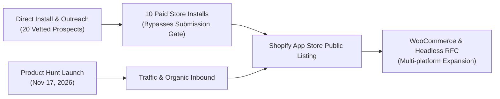

# AGENT.md — Developer & AI Agent Playbook

> **Target Audience:** Any AI assistant (Claude Code, Cursor, Antigravity, Copilot) or human engineer picking up this codebase.
> **Last Updated:** November 2026
> **Workspace Path:** `/Users/macbook/work/shopify/04-practitioner-protocols`
> **Test Suite:** 621 passing tests across 141 suites (`npm test`)

---

## 1. Project Overview & Mission

**Practitioner Protocols** is an open-source (MIT) Shopify application designed for direct-to-consumer health, wellness, skincare, salon, and professional brands that sell through certified practitioners, aestheticians, therapists, clinics, or coaches.

### The Problem It Solves
Brands often rely on practitioners to recommend products to clients. Traditionally, this is clumsy: practitioners write down product names on paper or send scattered affiliate links. Clients drop off, buy the wrong variants, or get frustrated in checkout.

### The Solution: 4 Integrated Roles
1. **Practitioner Portal (`/apps/protocols`):** Verified practitioners create, manage, and clone multi-product routine protocols directly inside the brand's storefront.
2. **Client Storefront Recommendation Page (`/apps/protocols/:token`):** Clients view a branded, responsive protocol page and add all recommended items to cart in a single tap at retail price.
3. **Printable QR Handout (`/apps/protocols/:token/handout`):** Practitioners can generate a clean, printable PDF/handout with a built-in mathematical SVG QR code for in-clinic handoffs.
4. **Embedded Merchant Admin (Polaris CSS):** Store merchants review practitioner applications, manage starter templates, trigger emergency protocol disablement, and view aggregate monthly attribution reports (by practitioner and by protocol).

---

## 2. Live Infrastructure & Core Credentials

| Environment / Service | Host / Endpoint | Details |
| :--- | :--- | :--- |
| **Custom Domain** | `https://practitioner.arsalandev.studio` | Primary production domain for all App Proxy, OAuth, Admin & Demo traffic. |
| **Interactive Demo** | `https://practitioner.arsalandev.studio/demo` | Standalone 4-role sandbox preview (no login or Shopify store required). |
| **Railway Hosting** | `practitioner-protocols-production.up.railway.app` | Backing Node.js runtime and managed PostgreSQL database. |
| **Shopify App Client ID** | `840a22df2708a4a51a443180b8c332db` | Partner Dashboard Client ID (`SHOPIFY_API_KEY`). |
| **Target Dev Store** | `ai-agent-app-h9qwnwd8.myshopify.com` | Primary development store for live OAuth & App Bridge testing. |
| **Direct Install Link** | `https://practitioner.arsalandev.studio/api/auth?shop=ai-agent-app-h9qwnwd8.myshopify.com` | Direct OAuth initiation endpoint. |
| **Product Hunt Launch** | Launch ID `1314660` | Scheduled for **Tuesday, Nov 17, 2026 at 00:00 PST**. |

---

## 3. Strict Architectural Rules & Constraints

Any AI agent modifying this repository **MUST** adhere to these non-negotiable rules:

1. **Zero Client PII & Zero Health Claims:**
   - Never store, accept, or transmit patient names, emails, phone numbers, conditions, medical records, or diagnostic terms.
   - The only exception is Milestone M11: an explicit, optional "Stay in touch" shopper opt-in contact card on the recommendation page (email, optional first name, timestamp, canonical consent text). This contact is strictly isolated from protocol and order data.
2. **Minimal Scopes (`read_orders` only):**
   - The app only requests `read_orders` to calculate aggregate monthly attribution via `orders/paid` webhooks.
   - Do NOT add write scopes or customer scopes without explicit user approval.
3. **Pure Engine / Zero External Dependencies:**
   - The pure engine modules have zero runtime dependencies beyond Node.js built-ins (`node:http`, `node:crypto`, `node:url`) and `pg` for database operations.
   - No heavy frameworks, no React/Webpack/Bite bundlers. Merchant admin Polaris styling is served via plain semantic HTML and Polaris CSS CDN.
4. **Deterministic & Backend-Enforced Security:**
   - Never rely on UI or front-end checks for authorization.
   - Every multi-tenant operation enforces shop and owner GID boundaries.
   - Access tokens stored at rest are encrypted with AES-256-GCM.
5. **Always Ask Before Commit / Push / Deploy:**
   - Ask the project owner before executing git commit, git push, Railway deploys, or submitting listings.

---

## 4. Current Status: The Shopify 10-Install Limit & The Pivot

### The Shopify App Store Block
Under Shopify's new app submission limits, organizations cannot submit a new public app for App Store review if any published app lacks **10 or more installs from merchants on paid plans**.
- Practitioner Protocols was moved back to Draft status ("Submission limited") in the Partner Dashboard.

### The Pivot: Direct Merchant Distribution (Option 3)
We are bypassing the public Shopify App Store review gate by distributing the app via **Direct Installation / Unlisted distribution**:
1. Merchants install directly using:
   `https://practitioner.arsalandev.studio/api/auth?shop=<store-name>.myshopify.com`
2. We target 20 curated health/wellness brands that already have practitioner or wholesale programs.
3. Prospects list is stored in:
   `Claude outputs/practitioner_prospects_20.csv`
   - High-fit targets: *The Herbtender* (UK), *Essential Oxygen* (US), *Pevonia UK*, *Flo Aromatherapy* (CA), *Skin O2* (AU).
4. Goal: Onboard 10+ paid merchants via direct relationship, fulfilling Shopify's requirement while building real revenue and usage.

---

## 5. Strategic Master Plan & Roadmap



### Phase 1: Direct Outreach & Store Onboarding (Immediate)
- **Goal:** Reach 10 active store installs from merchants on paid Shopify plans.
- **Lead List:** `Claude outputs/practitioner_prospects_20.csv`.
- **Value Proposition:** Turn manual practitioner recommendations into one-tap carts with full attribution and printable QR sheets, zero monthly fees.
- **Demo Asset:** `https://practitioner.arsalandev.studio/demo`.

### Phase 2: Product Hunt Launch Execution (Scheduled: Nov 17, 2026, 00:00 PST)
- **Status:** Launch ID `1314660` scheduled.
- **Assets:** 6 Full-HD screenshots, custom 1200x1200 app icon, scheduled first comment.
- **Action on Launch Day:** Monitor comments, engage with upvoters, drive traffic to `/demo`.

### Phase 3: Platform Hardening & Multi-Platform (Post-10 Installs)
- Resubmit to Shopify App Store once the 10-install criteria is fulfilled.
- Implement the WooCommerce & Headless Bridge RFC (documented in `launch_and_woocommerce_rfc.md`) to expand beyond Shopify.

---

## 6. Directory Structure & Key Files

```
04-practitioner-protocols/
├── AGENT.md                       # This playbook for AI agents
├── CLAUDE.md                      # Claude-specific hard rules and constraints
├── PROJECT_CONTEXT.md             # Append-only chronological engineering log
├── README.md                      # Public documentation and architecture overview
├── shopify.app.toml               # Shopify CLI configuration and scopes
├── server.js                      # Main HTTP server entry (Node.js >= 22 ESM)
│
├── app/lib/protocols/             # Pure Core Modules (Zero external deps)
│   ├── admin.js                   # Polaris HTML admin renderer & attribution CSV
│   ├── catalog.js                 # Variant resolver & predictive search hydration
│   ├── contacts.js                # Shopper opt-in contact capture & ShopProfile sync
│   ├── crypto.js                  # AES-256-GCM token encryption & HMAC verification
│   ├── database.js                # PostgreSQL pool, queries & migrations
│   ├── handout.js                 # Printable QR handout HTML generator
│   ├── permissions.js             # RBAC and multi-tenant authorization
│   ├── portal.js                  # Practitioner Portal Liquid renderer
│   ├── proxy.js                   # Shopify App Proxy request handling & Liquid
│   ├── qr.js                      # Pure mathematical SVG QR generator
│   ├── rate-limit.js              # Token bucket and window rate limiters
│   ├── routes.js                  # Central HTTP route dispatchers
│   ├── validation.js              # Protocol payload validation schemas
│   └── webhooks.js                # HMAC verification & compliance/attribution webhooks
│
├── app/lib/woocommerce/           # WooCommerce Platform Adapter (Zero external deps)
│   ├── cart.js                    # 1-tap cart & checkout permalinks + Store API batch payload
│   ├── catalog.js                 # WooCommerce Store API product search & normalization
│   └── webhooks.js                # WooCommerce HMAC-SHA256 signature verification & Zero-PII attribution
│
├── plugins/woocommerce/           # Companion WordPress Plugin (.zip distribution)
│   ├── practitioner-protocols.php # Native WP hook capturing ?protocol_token to session & order meta
│   └── readme.txt                 # WordPress.org plugin directory metadata
│
├── Claude outputs/
│   └── practitioner_prospects_20.csv  # 20 vetted direct-outreach merchant leads
│
├── scripts/
│   ├── migrate.js                 # Database schema migration runner
│   ├── contacts.mjs               # Merchant contact sync CLI
│   └── stats.mjs                  # Quick attribution query CLI
│
└── test/                          # 133 test suites (607 passing unit tests)
    ├── admin.test.js
    ├── attribution.test.js
    ├── catalog.test.js
    ├── contacts.test.js
    ├── crypto.test.js
    ├── handout.test.js
    ├── permissions.test.js
    ├── portal.test.js
    ├── proxy.test.js
    ├── rate-limit.test.js
    ├── routes.test.js
    ├── server.test.js
    ├── token.test.js
    ├── validation.test.js
    ├── webhooks.test.js
    └── woocommerce.test.js
```

---

## 7. Development & Testing Commands

All commands run with plain Node.js (no build or compile step needed):

```bash
# Run the complete unit test suite (607 tests)
npm test

# Run tests against a live local/remote PostgreSQL instance
npm run test:db

# Run a specific test suite
node --test test/routes.test.js

# Start local server in development mode
npm run dev

# Start server in production mode
npm start
```

---

## 8. Checklist for Next AI Agent

When continuing work on this repository:
1. **Run `npm test` first:** Ensure all 607 tests pass before making changes.
2. **Read `PROJECT_CONTEXT.md`:** See the latest decision log and engineering notes.
3. **Keep `shopify.app.toml` and `server.js` aligned:** Use `https://practitioner.arsalandev.studio` for URLs.
4. **No new dependencies:** Keep core modules dependency-free.
5. **Always update documentation:** If routes, schema, or behaviors change, update `README.md`, `AGENT.md`, and append to `PROJECT_CONTEXT.md`.
