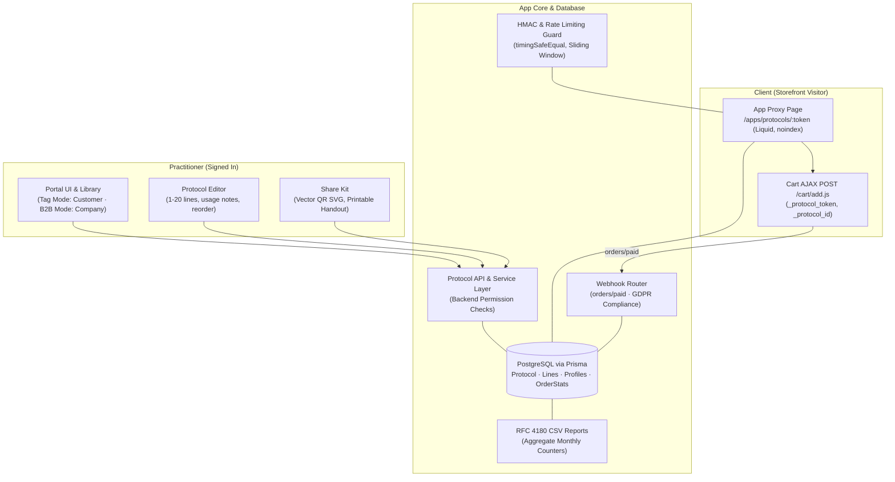

# Practitioner Protocols — Share Product Recommendations by Link or QR, Buy in One Tap

> **Open-Source (MIT)** | Built for the Shopify Merchant & Developer Community | Open for PRs & Discussions

> 🚀 **Status: Fully Built & Verified** | **205/205 Unit Tests Passing** | **4/4 PostgreSQL Integration Tests Passing**

---

## 1. Overview & Vision

**The problem:** Many direct-to-consumer and professional brands sell *through practitioners* — dermatologists, physical therapists, veterinarians, personal trainers, salons, and wellness clinics. The practitioner recommends a curated set of products in the clinic; the client forgets half of it, searches online, and buys somewhere else. The brand never learns which practices actually drive retail sales. The model that solves this (a "protocol": a named, reusable list of products with usage directions, shared by link) exists only inside closed supplement dispensaries. A brand running its own Shopify store has had no open equivalent.

**The approach:** A *protocol* is a reusable, professional product recommendation list. The practitioner builds it once, shares one permanent link or QR code with any number of clients, and the client lands on a theme-native storefront page where **one tap adds everything to their cart at normal retail prices**. The brand sees, in aggregate, which practices and protocols drive sales.

**Privacy by design:** Protocols never accept or store client/patient information. The validator strictly enforces a zero-PII barrier (`PII_NOT_ALLOWED`). Attribution is tracked solely via aggregate monthly counters.

---

## 2. Core Modules & Verified Features

### A. Share Tokens & Cryptography ([`app/lib/protocols/token.js`](file:///Users/macbook/work/shopify/04-practitioner-protocols/app/lib/protocols/token.js))
- Unguessable, URL-safe random alphanumeric tokens ($\ge 16$ characters) using `crypto.randomBytes`.
- Over 95 bits of cryptographic entropy, preventing enumeration attacks.
- Validated via `isValidShareToken`.

### B. Input Validation & Privacy Barrier ([`app/lib/protocols/validation.js`](file:///Users/macbook/work/shopify/04-practitioner-protocols/app/lib/protocols/validation.js))
- **Strict Zero-PII Enforcement:** Rejects any payload key matching `/(?:patient|client|ssn|health|medical|diagnosis|condition)/i` with `PII_NOT_ALLOWED`.
- Protocol name (1–60 chars), optional intro note ($\le 500$ chars), display name ($\le 60$ chars).
- Product lines (1–20 items), quantities (1–10 integers), and line usage instructions ($\le 200$ chars).
- Prohibits duplicate variant GIDs within a single protocol (`DUPLICATE_VARIANT`).
- Restricts `disabled` status modification and starter creation to administrators only.

### C. Permissions & Multi-Tenant Isolation ([`app/lib/protocols/permissions.js`](file:///Users/macbook/work/shopify/04-practitioner-protocols/app/lib/protocols/permissions.js))
- **Tag Mode (any Shopify plan):** Customer tagged `practitioner`. Owner = `customer`.
- **B2B Company Mode:** B2B company contact. Owner = `company`.
- Backend-enforced authorization across all actions (`read`, `create`, `edit`, `archive`, `restore`, `duplicate`, `delete`). Cross-owner access is strictly blocked (`FORBIDDEN_OWNERSHIP_MISMATCH`).
- **Starter Template Protection:** Brand starter templates are read-only and duplicable by practitioners, but cannot be modified, archived, or deleted by non-admins.
- **Disabled Isolation:** Protocols set to `disabled` cannot be accessed or modified by non-admins.

### D. Storefront App Proxy & Client Page ([`app/lib/protocols/proxy.js`](file:///Users/macbook/work/shopify/04-practitioner-protocols/app/lib/protocols/proxy.js))
- **HMAC Verification:** Validates Shopify App Proxy HMAC SHA-256 signatures with constant-time comparison (`crypto.timingSafeEqual`).
- **Theme-Native Liquid:** Generates `application/liquid` responses rendered inside `theme.liquid`.
- **Search Engine Isolation:** Injects `<meta name="robots" content="noindex, nofollow">` across all states.
- **Protocol Lifecycle States:**
  - `active`: Renders practice branding, intro notes, product cards with usage notes, and 1-tap **"Add all to cart"** via Cart AJAX (`POST /cart/add.js`) carrying hidden line item properties (`_protocol_token`, `_protocol_id`, `_protocol_usage`).
  - `archived`: Friendly "Protocol No Longer Active" card.
  - `disabled`: Friendly "Protocol No Longer Active" card.
  - `not_found`: Friendly "Protocol Not Found" card.
- **Professional Preview Banner:** Displays *"You're signed in as a professional. Clients will see retail prices."* when `logged_in_customer_id` matches the practitioner.

### E. Practitioner Portal ([`app/lib/protocols/portal.js`](file:///Users/macbook/work/shopify/04-practitioner-protocols/app/lib/protocols/portal.js))
- **Protocol Library:** Library card view with line counters, live retail price total calculation (`calculateProtocolRetailTotal`), starter template badges, and out-of-stock notices (*"1 product no longer available"*).
- **Protocol Editor:** Add/remove products, adjust quantities (1–10), set usage instructions, and reorder lines.
- **Concurrent Edit Detection:** Compares `updatedAt` to warn practitioners in the same practice if another member edited the protocol simultaneously (`PEER_PRACTITIONER_EDIT`).

### F. Vector QR Code & Printable Handout ([`app/lib/protocols/qr.js`](file:///Users/macbook/work/shopify/04-practitioner-protocols/app/lib/protocols/qr.js), [`handout.js`](file:///Users/macbook/work/shopify/04-practitioner-protocols/app/lib/protocols/handout.js))
- Pure JavaScript ISO/IEC 18004 QR generator (zero external dependencies, zero native binaries).
- Output: Scalable, crisp vector SVG with Reed-Solomon Error Correction Level M (15% recovery).
- Print-ready single-page HTML/CSS handout with `@media print` rules for US Letter and A4, XSS-escaped dynamic fields, practice branding, routine table, and embedded QR code.

### G. Order Attribution & Reports ([`app/lib/protocols/attribution.js`](file:///Users/macbook/work/shopify/04-practitioner-protocols/app/lib/protocols/attribution.js), [`admin.js`](file:///Users/macbook/work/shopify/04-practitioner-protocols/app/lib/protocols/admin.js))
- **Mixed-Cart Isolation:** Webhook extractor isolates lines carrying `_protocol_token` and `_protocol_id`, ignoring organic store items.
- **Atomic Counters:** Increments monthly order counts, units sold, and revenue in minor currency units (cents) in `ProtocolOrderStat`.
- **RFC 4180 CSV Export:** Exports monthly attribution reports with proper escaping, quotes, and CRLF line terminators (strictly aggregate counters; zero client PII).

### H. Merchant Admin Management ([`app/lib/protocols/admin.js`](file:///Users/macbook/work/shopify/04-practitioner-protocols/app/lib/protocols/admin.js))
- **Practitioner Approvals & Anti-Impersonation:** Merchant controls practice names (`PractitionerProfile`) to prevent unauthorized clinic representation.
- **Starter Templates Manager:** Brand administrators create and manage starter templates (`isStarter = true`).
- **Emergency Disable:** Single-protocol or storewide protocol killswitch (`status: 'disabled'`).
- **App Settings:** Configures storefront identity mode (`tag` vs `company`), custom legal disclaimers, and print instructions.

### I. Security Hardening & Rate Limiter ([`app/lib/protocols/rate-limit.js`](file:///Users/macbook/work/shopify/04-practitioner-protocols/app/lib/protocols/rate-limit.js))
- In-memory sliding-window log rate limiter with zero external dependencies.
- Prevents token enumeration, scraping, and brute-force attacks on public App Proxy endpoints.
- Auto-pruning with `maxKeys` eviction cap and unreferenced cleanup intervals to prevent memory leaks.
- Employs RFC-compliant HTTP headers (`X-RateLimit-Limit`, `X-RateLimit-Remaining`, `Retry-After`).

### J. Mandatory Compliance Webhooks ([`app/lib/protocols/webhooks.js`](file:///Users/macbook/work/shopify/04-practitioner-protocols/app/lib/protocols/webhooks.js))
- `customers/data_request`: Reports practitioner profile and protocol references (confirms zero client PII stored).
- `customers/redact`: Tag mode removes practitioner profile and archives/deletes protocols; Company mode preserves company protocols and scrubs personal creator references.
- `shop/redact`: Deletes all shop protocols, lines, stats, profiles, settings, and sessions.
- `app/uninstalled`: Revokes all active shop sessions immediately.

---

## 3. Architecture & Data Flow



---

## 4. Database Schema (Prisma)

The PostgreSQL data model is defined in [`prisma/schema.prisma`](file:///Users/macbook/work/shopify/04-practitioner-protocols/prisma/schema.prisma):

- **`Protocol`**: ID, shop, token (unique, $\ge 16$ chars), name ($\le 60$), introNote ($\le 500$), displayName, ownerType (`customer` or `company`), ownerId, createdBy, updatedBy, status (`active`, `archived`, `disabled`), isStarter, sourceProtocolId, timestamps.
- **`ProtocolLine`**: ID, protocolId (cascade delete), position, variantGid, quantity (1–10), usageNote ($\le 200$), unique on `(protocolId, variantGid)`.
- **`PractitionerProfile`**: ID, shop, ownerType, ownerGid, practiceName (merchant-controlled), logoUrl, isApproved, unique on `(shop, ownerGid)`.
- **`ProtocolOrderStat`**: ID, shop, protocolId, ownerId, month (`YYYY-MM`), orders, units, revenueMinor (BigInt, cents), currency, unique on `(shop, protocolId, month)`.
- **`Setting`**: Shop (PK), identityMode (`tag` vs `company`), footerDisclaimer, handoutText.
- **`Session`**: Shopify session storage table matching `@shopify/shopify-app-session-storage-prisma`.

---

## 5. Local Setup & Testing

### Prerequisites
- Node.js $\ge 22.12$ (verified on Node v24)
- PostgreSQL running locally (default port 5432)

### Installation
```bash
cd 04-practitioner-protocols
npm install
```

### Database Configuration
Create a local `.env` file (ignored by Git):
```env
DATABASE_URL=postgresql://macbook@localhost:5432/practitioner_protocols
```

Apply migrations:
```bash
# Generated DDL migration:
prisma/migrations/20261021_init/migration.sql
```

### Running Tests
The project features a deterministic test suite using native Node.js test runner (`node:test`):

```bash
# Run all 205 pure unit tests (zero external network dependencies, ~75ms):
npm test

# Run PostgreSQL live database integration tests:
npm run test:db

# Run all unit and integration tests:
npm run test:all
```

---

## 6. Directory Structure

```text
04-practitioner-protocols/
├── app/
│   └── lib/
│       └── protocols/
│           ├── token.js         # Cryptographic share token generator & validator
│           ├── validation.js    # Schema validation & zero-PII enforcement barrier
│           ├── permissions.js   # Authorization guard (Tag vs B2B Company mode)
│           ├── attribution.js   # Cart AJAX payload builder & webhook line extractor
│           ├── qr.js            # Pure vector QR SVG generator (GF(256) Reed-Solomon)
│           ├── handout.js       # Printable HTML/CSS handout generator (Letter & A4)
│           ├── proxy.js         # App Proxy HMAC verifier & theme Liquid renderer
│           ├── portal.js        # Practitioner portal library, editor, & concurrent edit check
│           ├── admin.js         # Merchant admin controls & RFC 4180 CSV export
│           ├── rate-limit.js    # In-memory sliding-window rate limiter
│           ├── webhooks.js      # Shopify compliance & order attribution webhooks
│           ├── service.js       # Transactional PostgreSQL service layer
│           └── routes.js        # HTTP request controllers & webhook router
├── prisma/
│   ├── schema.prisma            # PostgreSQL data models
│   └── migrations/
│       └── 20261021_init/       # Initial PostgreSQL DDL migration
├── test/
│   ├── token.test.js            # Token entropy & format tests
│   ├── validation.test.js       # Input bounds & PII rejection barrier tests
│   ├── permissions.test.js      # Role & ownership isolation tests
│   ├── attribution.test.js      # Cart payload & mixed-cart attribution tests
│   ├── handout.test.js          # QR SVG & printable handout tests
│   ├── proxy.test.js            # App Proxy HMAC & Liquid state tests
│   ├── portal.test.js           # Library, editor, & concurrent-edit tests
│   ├── admin.test.js            # Approvals, starters, disable, & CSV export tests
│   ├── rate-limit.test.js       # Sliding window rate limiter tests
│   ├── webhooks.test.js         # GDPR compliance & orders/paid webhook tests
│   ├── routes.test.js           # HTTP API controllers & router tests
│   └── database.integration.test.js # Live PostgreSQL integration tests
├── docs/
│   ├── BUILD_PLAN.md            # Milestones and progress tracker
│   ├── M1_CONTRACT.md           # Runtime contract specification
│   └── SPEC.md                  # Comprehensive architectural specification
├── CLAUDE.md                    # Repository conventions & safety agreements
├── PROJECT_CONTEXT.md           # Append-only chronological engineering log
└── package.json                 # Native ESM package manifest
```

---

## 7. Security, Privacy & Compliance Guarantees

1. **Zero Client/Patient PII:** Validated across all layers. The app neither accepts, stores, nor transmits client identities, emails, phone numbers, or health information.
2. **Timing-Safe Cryptography:** All HMAC signatures (App Proxy and Webhooks) are verified using `crypto.timingSafeEqual` with byte-length equality checks.
3. **100% Parameterized SQL:** Database interactions use parameterized queries (`$1, $2, ...`) within explicit database transactions (`BEGIN`/`COMMIT`/`ROLLBACK`).
4. **XSS & Injection Sanitization:** All dynamic user fields rendered in Liquid or HTML handouts are sanitized via `escapeHtml`, and script JSON payloads encode `<` as `\u003c`.
5. **No Search Indexing:** App Proxy responses unconditionally include `<meta name="robots" content="noindex, nofollow">` to prevent indexing of shared recommendations.
6. **Rate Limiting:** Public proxy routes are guarded by sliding-window rate limiting to prevent scraping and token guessing.
7. **GDPR Ready:** Fully handles `customers/data_request`, `customers/redact`, `shop/redact`, and `app/uninstalled`.

---

## 8. License & Contact

- **License:** MIT License — Open for the Shopify merchant and developer community.
- **Maintainer:** Arsalan Arshad ([arsalanarshad.dev@gmail.com](mailto:arsalanarshad.dev@gmail.com))
