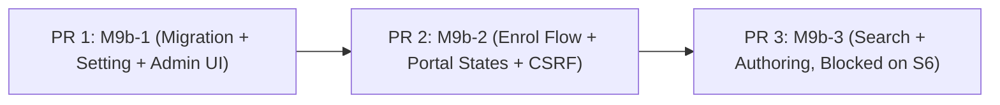

# M9b Design — Practitioner Self-Enrolment & Production Protocol Authoring

_Written 2026-11-03. Implements BUILD_PLAN M9b / SPEC §2, §3, §4, §5, §6, §7, §11. Proposed approach for catalog search; S6 open until verified on the dev store (to be confirmed by a dev-store spike)._

---

## Executive Summary & Definition of Done

**Milestone Objective:**  
Transition the practitioner-facing protocol workflow from in-memory demo mode into production backed by PostgreSQL, App Proxy authenticated sessions, and merchant admin controls, without adding any new Shopify API scopes and without capturing client/patient PII.

**M9b Done =**
1. **Schema & Migration:** `prisma/schema.prisma` and PostgreSQL include `allowSelfEnrol` (boolean, default `false`) on the `Setting` table, tracked in `scripts/migrate.js` via migration `20261103_add_allow_self_enrol.sql`.
2. **Merchant Admin Controls:** The Settings tab in `renderAdminHtml` displays the self-enrolment toggle. Updating settings persists `allowSelfEnrol` (absent field remains unchanged). The Practitioners tab renders pending self-enrolled practitioners (with links to the Shopify admin customer record) and reuses existing endpoints (`/api/admin/practitioners/status` and `/api/admin/practitioners/practice-name`) keyed by `ownerGid`.
3. **Storefront Self-Enrolment (Option 1):** Signed-in customers arriving at the App Proxy (`/apps/protocols`) without an existing profile see an explicit "Request practitioner access" prompt when `allowSelfEnrol === true`. Submitting POST `action=enrol` creates a pending profile (`isApproved = false`, zero PII, canonical GID, `ownerType: 'customer'`). When disabled or when `identityMode === 'company'`, no record is written and an invite-only notice is displayed.
4. **CSRF & Mutation Hardening:** Mutating App Proxy routes require `Content-Type: application/json` and reject form-encoded mutating bodies with HTTP 415. If `Sec-Fetch-Site` is present, it must be `same-origin` (else 403).
5. **Variant Display & Validation:** Protocol authoring and client rendering approach documented with clear delineation of residual risks and dependency on Spike S6 findings.
6. **Test Suite Green:** All existing 384 tests pass, accompanied by new tests confirming the new migration is in `MIGRATION_FILES` and applies idempotently, settings persistence, pending profile caps (default 200), CSRF rejection, and Rule-4 authorization boundaries.

---

## 1. Architectural Principles & Scope Discipline

1. **Strict Scope Discipline:**  
   The application continues to operate solely under the `read_orders` scope in `shopify.app.toml`. Neither `read_customers` nor `read_products` / `unauthenticated_read_product_listings` are requested.
2. **Zero-PII Identity Barrier:**  
   Practitioners are identified exclusively via the HMAC-verified Shopify customer GID (`gid://shopify/Customer/<id>`) provided by Shopify App Proxy's signed `logged_in_customer_id` parameter. No customer name, email, phone number, physical address, or health records are accepted or persisted. In merchant admin, pending rows display a direct link to the customer page in Shopify admin (`https://${shop}/admin/customers/${numericId}`) so the merchant can review the customer in Shopify's native admin without the app storing PII.
3. **Tenant & Multi-Shop Isolation:**  
   All database operations for settings, practitioner profiles, protocols, and lines are partitioned by the verified `shop` domain. Cross-shop data access is rejected.
4. **Merchant Authority:**  
   Self-enrolment is **off by default**. An enrol request creates a profile strictly with `isApproved: false`. The practitioner cannot create, edit, or publish protocols until the merchant explicitly approves them via `/api/admin/practitioners/status` and assigns their official practice name via `/api/admin/practitioners/practice-name`.

---

## 2. Database Schema & Migration Architecture

### 2.1 Prisma Schema (`prisma/schema.prisma`)
Add `allowSelfEnrol` to the `Setting` model:
```prisma
model Setting {
  shop             String   @id
  identityMode     String   @default("tag") // 'tag' (default) | 'company' (B2B)
  allowSelfEnrol   Boolean  @default(false) // Practitioner self-enrolment via App Proxy (default off)
  footerDisclaimer String?  // Optional custom legal or brand disclaimer
  handoutText      String?  // Custom print instructions for handouts
  createdAt        DateTime @default(now())
  updatedAt        DateTime @updatedAt
}
```

### 2.2 PostgreSQL Migration (`prisma/migrations/20261103_add_allow_self_enrol/migration.sql`)
```sql
-- AlterTable: Add allowSelfEnrol column to Setting table
ALTER TABLE "Setting" ADD COLUMN IF NOT EXISTS "allowSelfEnrol" BOOLEAN NOT NULL DEFAULT false;
```

### 2.3 Migration Runner (`scripts/migrate.js`)
Update `MIGRATION_FILES`:
```javascript
const MIGRATION_FILES = [
  join(ROOT_DIR, 'prisma/migrations/20261021_init/migration.sql'),
  join(ROOT_DIR, 'prisma/migrations/20261022_add_currency_to_stat_unique_and_idempotency/migration.sql'),
  join(ROOT_DIR, 'prisma/migrations/20261103_add_allow_self_enrol/migration.sql')
];
```
- Migration runner ensures atomic execution within `BEGIN ... COMMIT` and records the migration ID `'20261103_add_allow_self_enrol'` in `_pp_migrations`.
- Existing integration tests assert against `MIGRATION_FILES.length`; add a test that the new migration is in `MIGRATION_FILES` and applies idempotently.

---

## 3. Merchant Admin Settings & Approval Workflow

### 3.1 Settings Data Access (`app/lib/protocols/admin.js`)
1. **`getSettings(db, { shop })`**:
   - `SELECT` query retrieves `"allowSelfEnrol"`.
   - Fallback object for unconfigured stores:
     ```javascript
     { shop, identityMode: 'tag', allowSelfEnrol: false, footerDisclaimer: null, handoutText: null }
     ```
2. **`updateSettings(db, { shop, settings, adminUser })`**:
   - **Absent field rule:** If `settings.allowSelfEnrol === undefined`, the existing value in PostgreSQL remains unchanged (not reset to `false`).
   - If provided:
     ```javascript
     const allowSelfEnrol = typeof settings.allowSelfEnrol === 'boolean'
       ? settings.allowSelfEnrol
       : ['true', '1', 'on'].includes(String(settings.allowSelfEnrol).toLowerCase());
     ```
   - In SQL upsert:
     ```sql
     ON CONFLICT ("shop") DO UPDATE SET
       "allowSelfEnrol" = COALESCE($5, "Setting"."allowSelfEnrol"),
       ...
     ```

### 3.2 Merchant Admin UI (`renderAdminHtml`)
In the Settings tab (`renderSettingsTab`), the HTML form sends a hidden input preceding the checkbox so unchecking submits `false`:
```html
<div style="margin-bottom: 1.25rem;">
  <input type="hidden" name="allowSelfEnrol" value="false">
  <label style="display: flex; align-items: flex-start; gap: 0.5rem; cursor: pointer;">
    <input type="checkbox" name="allowSelfEnrol" value="true" ${settings?.allowSelfEnrol ? 'checked' : ''} style="margin-top: 0.2rem; width: 1.125rem; height: 1.125rem;">
    <div>
      <span style="font-weight: 600; display: block;">Allow Practitioner Self-Enrolment</span>
      <span style="color: var(--p-color-text-subdued); font-size: 0.8125rem;">
        When enabled, signed-in customers visiting the protocol portal can submit an enrolment request for your review. (Tag mode only).
      </span>
    </div>
  </label>
</div>
```

### 3.3 Practitioner Directory & Approval Action
Reuse the existing admin endpoints without modifying their contracts:
1. **Approval / Revocation:** `POST /api/admin/practitioners/status`
   - Payload: `{ ownerGid: string, isApproved: boolean }` (or `action: 'approve' | 'revoke'`).
   - Invokes `setPractitionerApproval(db, { shop, ownerGid, isApproved })`.
2. **Practice Name Assignment:** `POST /api/admin/practitioners/practice-name`
   - Payload: `{ ownerGid: string, practiceName: string }`.
   - Invokes `updatePracticeName(db, { shop, ownerGid, practiceName })`.
3. **Admin UI Display:**
   - Pending rows show the requested practice name marked with a tag: `"(requested, unverified)"`.
   - Display a direct link to the Shopify admin customer record:
     ```html
     <a href="https://${shop}/admin/customers/${numericCustomerId}" target="_blank" rel="noopener noreferrer">
       View Customer #${numericCustomerId}
     </a>
     ```

---

## 4. App Proxy Self-Enrolment & Portal Lifecycle

### 4.1 Flow Matrix

| State | Customer Logged In? | Profile in DB? | `identityMode` | `allowSelfEnrol` | Outcome |
|---|---|---|---|---|---|
| **Guest** | No | N/A | Any | Any | Render "Practitioner Sign In Required" with `/account/login` link |
| **Enrolled Approved** | Yes | Yes (`isApproved: true`) | Any | Any | Render Active Protocol Library + Editor Modal |
| **Enrolled Pending** | Yes | Yes (`isApproved: false`)| Any | Any | Render "Account Pending Approval" notice |
| **New Customer (Tag mode, open)** | Yes | No | `'tag'` | `true` | Render "Request Practitioner Access" form (`action=enrol`) |
| **New Customer (Tag mode, closed)**| Yes | No | `'tag'` | `false` | Render "Practitioner Program (Invite Only)" notice; **no row written** |
| **New Customer (Company mode)** | Yes | No | `'company'` | Any | Render "B2B Company Access Required" notice; **no row written** |

### 4.2 Explicit Enrolment Submission (`POST /apps/protocols?action=enrol`)
Enrolment is **never executed on a GET request**. It requires an explicit user POST:
1. **Preconditions:**
   - App Proxy HMAC signature verified.
   - `customerGid` present from `logged_in_customer_id`.
   - `identityMode === 'tag'` (company mode does not support self-enrolment).
   - `settings.allowSelfEnrol === true`.
2. **Per-Shop Pending Cap:**
   - Query: `SELECT COUNT(*) FROM "PractitionerProfile" WHERE "shop" = $1 AND "isApproved" = false`.
   - If count >= 200 (default cap): Reject request with HTTP 429 / capacity limit message ("Enrolment is temporarily at capacity. Please contact the store administrator.").
   - *Note on status:* Revoked practitioners are stored as `isApproved: false`, making them indistinguishable from pending rows at the database level; they count toward the pending cap.
   - *Note on concurrency:* The pending cap is a soft limit under concurrency (concurrent requests may slightly exceed 200 before the cap check commits).
3. **Rate Limiting:**
   - Sliding-window IP limiter and per-customer limiter enforced.
4. **Requested Practice Name:**
   - Optional input, trimmed length $\le 60$ characters.
   - Sanitized via `validatePracticeName` (PII rejected via `assertNoPii`).
   - Default if blank: `"Pending Practitioner"`.
5. **Database Insertion:**
   ```sql
   INSERT INTO "PractitionerProfile" (
     "id", "shop", "ownerType", "ownerGid", "practiceName", "isApproved", "createdAt", "updatedAt"
   ) VALUES (
     $1, $2, 'customer', $3, $4, false, NOW(), NOW()
   )
   ON CONFLICT ("shop", "ownerGid") DO NOTHING
   RETURNING *;
   ```
   - `id`: Generated via `generateShareToken(16)`.
   - `ownerType`: `'customer'`.
   - `ownerGid`: canonical `customerGid`.
   - Idempotent: Subsequent submissions return existing pending profile.

---

## 5. Product Search in Production (Spike S6 Answered)

> [!NOTE]
> **Spike S6 Status: ANSWERED (2026-11-04 on dev store `ai-agent-app-h9qwnwd8`, signed-in storefront).**  
> Empirical findings from the live dev store confirmed the predictive search contract, variant resolution workflow, and client-side execution model. Milestone M9b-3 is unblocked.

### 5.1 Empirical Findings on Live Dev Store
1. **`/search/suggest.json` Contract:**
   - Endpoint: `GET /search/suggest.json?resources[type]=product&resources[options][unavailable_products]=show&q=${query}`
   - Returns up to 10 products with fields: `id` (numeric), `handle`, `title`, `price` (formatted string e.g. `"945.00"`), `available` (boolean), `image`, `url`.
   - The `variants` array is present in the response but was **EMPTY** (`variants: []`) across all 10 results tested.
   - Empty query returns HTTP 422 Unprocessable Entity. No match returns HTTP 200 with empty results.
   - Throttling: 25 rapid requests all returned HTTP 200 without rate-limit errors.
   - Unavailable products are returned when requested (`available: false`).
2. **`/products/<handle>.js` Contract:**
   - Endpoint: `GET /products/${handle}.js`
   - Returns full product and variant records: `id` (numeric), `title`, `price` in **minor currency units** (cents e.g. `94500` for $945.00), `available`, `sku`, `quantity_rule`.
3. **Server-Side Fetch vs Client-Side Execution:**
   - Anonymous requests to `/search/suggest.json` from outside the browser redirect to `/password` when storefront password protection is active.
   - Server-side fetch from Node/Railway is **not relied on** and was left untested from Railway.
   - **Architecture Decision:** All catalog and search calls are strictly **client-side from the storefront origin**. The backend server never fetches the storefront.
4. **Untested Conditions:**
   - B2B / contextual pricing for a logged-in B2B buyer was not tested in S6 (future enhancement).

---

## 6. Variant Display & Validation in Production

### 6.1 Current Schema & Resolver Limitation
- In PostgreSQL, `ProtocolLine` currently stores `variantGid`, `quantity`, `position`, and `usageNote`.
- In demo mode, `resolveVariants` relied on `createFakeVariantResolver` with a hardcoded demo variant.
- In production, the app operates strictly under `read_orders` without `read_products` or Storefront API access tokens.

### 6.2 Display Architecture & Resolution Decision: Option A Selected
- **Selected: Option A (Client-Side Hydration via Product Handle):**
  - Milestone M9b-3 adds `ProtocolLine.productHandle` via a new Prisma schema migration.
  - The protocol editor performs client-side search: `GET /search/suggest.json` with minimum query length (e.g. 2 chars) and debounce (300ms) $\rightarrow$ upon selection or inspection, fetches `GET /products/${handle}.js` to obtain variant arrays, titles, and minor-unit prices.
  - On protocol display / edit, lines are hydrated client-side from `/products/${handle}.js` matching on `variantGid`.
  - Production `/api/proxy` removes `createFakeVariantResolver` so real production stores never display demo data.

### 6.3 Backend Validation for Protocol Create & Update
When an approved practitioner calls `POST action=create` or `POST action=update`:
- **Format Validation:** Each `variantGid` is validated against canonical format `^gid://shopify/ProductVariant/\d+$` and length limits ($\le 100$ characters). `productHandle` is validated against handle format.
- **Residual Risk:** Without `read_products` or Storefront API query access, the backend cannot verify whether a submitted `variantGid` actually exists in the merchant's store, is currently published, or is available for sale.
- **Failure Mode:** If an invalid, removed, or foreign variant ID is saved, the error will manifest downstream when the client attempts to add the line to cart or view product details.

---

## 7. CSRF & Mutation Hardening for App Proxy

Because App Proxy endpoints can be reached from browser contexts, all mutating routes (`action=enrol`, `action=create`, `action=update`, `action=archive`) must enforce strict anti-CSRF measures:

1. **Mandatory JSON Content-Type:**
   - Mutating requests must use HTTP `POST`.
   - `Content-Type: application/json` is mandatory on mutating routes (else HTTP 415 Unsupported Media Type).
   - Form-encoded requests (`application/x-www-form-urlencoded` or `multipart/form-data`) on mutating proxy routes are strictly rejected.
2. **Fetch Metadata / Origin Policy:**
   - If `Sec-Fetch-Site` header is present, it must be `"same-origin"` (else HTTP 403 Forbidden).
   - **Do not compare `Origin` to the `myshopify.com` domain:** Stores with custom domains send their primary domain (e.g. `https://example.com`) while `shop` is `example.myshopify.com`, which would reject legitimate requests; furthermore, header forwarding of `Origin` through the Shopify App Proxy is unverified.
3. **HMAC Signature:**
   - Every proxy request must continue to pass `verifyAppProxyHmac`.

---

## 8. Sequential Implementation Roadmap

Rather than running 4 parallel subagents simultaneously, implementation will proceed through three sequential, reviewable milestones:



### PR 1: Milestone M9b-1 — Migration, Setting, and Admin Controls (VERIFIED LIVE on dev store 2026-11-04)
- **Scope:**
  - Add `allowSelfEnrol` to `prisma/schema.prisma` and create `20261103_add_allow_self_enrol/migration.sql`.
  - Update `scripts/migrate.js` `MIGRATION_FILES` array.
  - Update `getSettings` and `updateSettings` in `app/lib/protocols/admin.js` (preserve value if absent).
  - Update `renderSettingsTab` with hidden input + checkbox.
  - Display pending practitioners in `renderAdminHtml` with Shopify admin customer links.
- **Done Criteria:**
  - All 384 existing tests pass (443 total unit tests passing).
  - Test added confirming the new migration is in `MIGRATION_FILES` and applies idempotently.
  - New tests for `allowSelfEnrol` defaults, partial update preservation, and admin HTML rendering.
  - **Live Verification:** Toggle renders (migration applied on deploy), saves and persists across reloads; toggled back off after test.

### PR 2: Milestone M9b-2 — Self-Enrolment Flow, Portal States, and CSRF (VERIFIED LIVE on dev store 2026-11-04)
- **Scope:**
  - Implement `POST action=enrol` in `handleAppProxyRequest`.
  - Enforce per-shop pending cap (200) and rate limits (5/hr per customer).
  - Enforce CSRF headers (`Content-Type: application/json` required -> 415; `Sec-Fetch-Site: same-origin` if present -> 403; unknown action -> 400).
  - Render portal liquid states: Enrolment form, Pending approval notice, and Invite-only notice.
  - Wire existing admin endpoints (`/api/admin/practitioners/status` and `/practice-name`).
- **Done Criteria:**
  - All tests green (443 unit tests passing across 102 suites).
  - Test coverage for enrolment creation, idempotency, pending cap, CSRF rejection, and Rule-4 authorization checks.
  - **Live Verification:** Logged-in customer sees request form; JSON POST through App Proxy (body and `Content-Type: application/json` preserved); 201 -> "Account Pending Approval" with requested name; admin shows pending row with customer deep link and `(requested, unverified)`; Approve -> approved library renders; form-encoded and `text/plain; application/json` POSTs -> 415; unknown action -> 400. `Sec-Fetch-Site` presence after proxy was not observed; rule (reject only if present and `!= same-origin`) is safe either way.

### PR 3: Milestone M9b-3 — Product Search & Production Authoring (UNBLOCKED — Spike S6 Answered, Option A Chosen)
- **Scope:**
  - Unblocked by findings from Spike S6 on dev store (`ai-agent-app-h9qwnwd8`).
  - Wire `/apps/protocols?action=search` based on Option A (client-side `suggest.json` -> `/products/<handle>.js` hydration; debounce + min query length).
  - Add `ProtocolLine.productHandle` schema migration.
  - Remove `createFakeVariantResolver` from production `/api/proxy` in `server.js`.
  - Implement production protocol create and update handlers writing to PostgreSQL.
- **Done Criteria:**
  - Full end-to-end authoring verified in production mode.
  - All unit and integration tests passing.

---

## 9. Test & Verification Plan

### 9.1 Test Cases to Implement

1. **Migration Ledger & Runner:**
   - Test that the new migration `20261103_add_allow_self_enrol` is included in `MIGRATION_FILES`.
   - Test that the migration applies cleanly and idempotently on subsequent runs.
2. **Settings Isolation & Partial Updates:**
   - Unconfigured shop returns `allowSelfEnrol: false`.
   - Calling `updateSettings` with `{ footerDisclaimer: 'Text' }` leaves existing `allowSelfEnrol` unchanged.
   - Form-encoded `allowSelfEnrol=false` followed by `allowSelfEnrol=true` parses to `true`.
   - Unchecked form sending only `allowSelfEnrol=false` persists `false`.
3. **Self-Enrolment & Pending Cap:**
   - Calling `action=enrol` in Tag mode with `allowSelfEnrol: true` inserts pending profile (`isApproved: false`, canonical customer GID, zero PII).
   - Calling `action=enrol` when 200 pending profiles already exist returns 429 / capacity error.
   - Repeated `action=enrol` calls by the same customer are idempotent (`ON CONFLICT DO NOTHING`).
   - Calling `action=enrol` when `allowSelfEnrol: false` or `identityMode: 'company'` is rejected.
4. **CSRF Enforcement:**
   - Mutating proxy POST without `Content-Type: application/json` returns 415.
   - Mutating proxy POST with form-encoded body returns 415.
   - Mutating proxy POST with `Sec-Fetch-Site: cross-site` returns 403.
   - Mutating proxy POST with `Sec-Fetch-Site: same-origin` (or omitted) with valid JSON is accepted.
5. **Rule-4 Authorization & Boundary Checks:**
   - **Cross-Owner Update/Archive:** Practitioner A attempting to update or archive Practitioner B's protocol returns 404 / Forbidden.
   - **Pending & Revoked Practitioners:** Practitioner with `isApproved: false` attempting `action=create` or `action=update` is blocked.
   - **Starter Immutability:** Attempts to edit or delete starter protocols (`isStarter: true`) by practitioners are rejected.
   - **Cross-Shop Isolation:** Practitioner from Shop A cannot view, create, or modify protocols on Shop B.
   - **Link Revocation Behaviour:** Existing share links for protocols authored by a revoked practitioner remain accessible to clients if active (preventing client disruption), but the practitioner cannot log in or edit them.

### 9.2 Manual Dev Store Verification (COMPLETED on dev store 2026-11-04)
1. **[VERIFIED]** Open Admin -> Settings -> Toggle "Allow Practitioner Self-Enrolment" on and off; verify state persists across reload.
2. **[VERIFIED]** Visit storefront `/apps/protocols` logged in as customer -> Submit "Request Practitioner Access".
3. **[VERIFIED]** Open Admin -> Practitioners -> Verify pending row with requested practice name and customer link -> Approve and set practice name.
4. **[VERIFIED]** Refresh storefront -> Verify active portal loads.
5. **[VERIFIED]** CSRF Proxy Verification: Confirmed on the dev store that JSON POST body and `Content-Type: application/json` survive Shopify App Proxy transit; confirmed form-encoded and `text/plain; application/json` POSTs return HTTP 415; unknown action returns HTTP 400.
